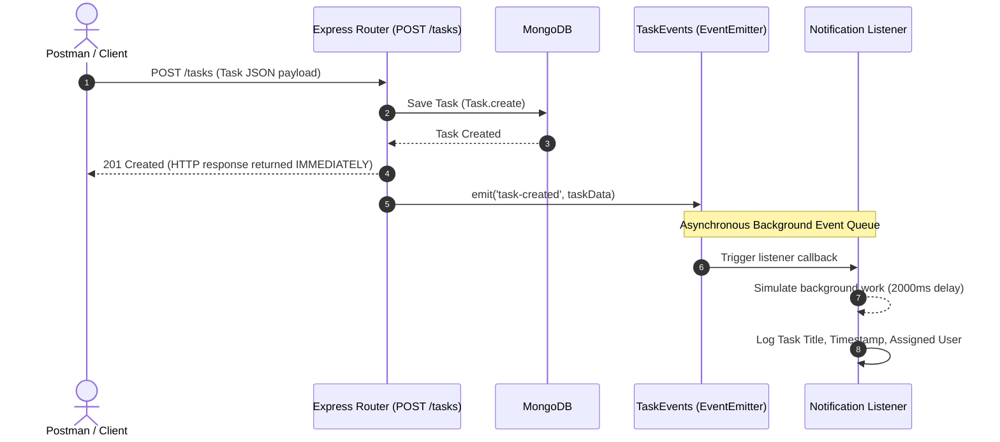
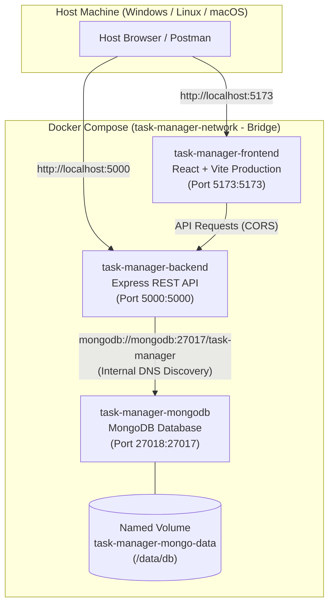

# Task Management RESTful API with Express & Mongoose / MongoDB

## Overview
This repository contains a complete Express.js RESTful API implementation for a **Task Management System** connected to **MongoDB** using **Mongoose ODM**. It demonstrates Express middleware pipelines, Mongoose schema validation (required fields, default values, pre-save hooks, enums), centralized error handling, and environment variable configuration using `dotenv`.

---

## Theory & Self-Study Reference (Viva / Key Questions)

### 1. What is the purpose of a schema in a NoSQL database like MongoDB, given that MongoDB itself is schema-less?
While MongoDB is natively schema-less (allowing documents in the same collection to have arbitrary fields), application data integrity requires consistent structure. A **Mongoose schema** defines document shape, data types, required constraints, default values, and custom validators at the application layer. This provides predictability, prevents corrupt data insertions, and simplifies querying.

### 2. Why is it important to define required fields and default values at the schema level rather than relying on frontend validation alone?
Frontend validation can be bypassed easily by tools like Postman, cURL, or compromised client code. Enforcing `required` fields and `default` values at the **Mongoose schema level** guarantees that no invalid data can reach the database regardless of the request source, serving as the ultimate authority for data integrity.

### 3. What happens internally when a document fails Mongoose validation — where is the request stopped?
When `Task.create()` or `save()` is executed, Mongoose runs synchronous/asynchronous schema validation rules **before** serializing and transmitting the BSON document over the wire to MongoDB. If validation fails, Mongoose halts execution locally before making any network call to the database and throws a `ValidationError`. When wrapped in `try/catch` with `next(err)`, Express catches this error and passes it down to the global error handler middleware.

---

## System Architecture

```
Client Request (Postman / Thunder Client)
                 │
                 ▼
     [requestLogger Middleware]
                 │
                 ▼
     [express.json() Body Parser]
                 │
                 ▼
 [contentTypeValidator Middleware]
                 │
                 ▼
        Express Router (/tasks)
    ┌────────────┼────────────┐
 GET /tasks  POST /tasks  PUT /tasks/:id  DELETE /tasks/:id
                 │            │
                 ▼            ▼
             Mongoose Schema & Pre-Save Hook
           (trims title, checks enum priority)
                 │
                 ▼
          MongoDB Database
        └── tasks collection
            { title, description, completed, priority, createdAt }
```

---

## Environment Setup (`.env`)

Create a `.env` file in the root directory (excluded via `.gitignore`):

```env
PORT=5000
MONGO_URI=mongodb://127.0.0.1:27017/task-manager
# MONGO_URI=mongodb+srv://<username>:<password>@cluster0.example.mongodb.net/task-manager?retryWrites=true&w=majority
```

A template file `.env.example` is included in the repository.

---

## Task Schema Specification (`models/Task.js`)

| Field | Type | Rules & Constraints | Default |
| :--- | :--- | :--- | :--- |
| `title` | `String` | **Required**, auto-trimmed pre-save hook | N/A |
| `description` | `String` | Auto-trimmed | `""` |
| `completed` | `Boolean` | Boolean flag | `false` |
| `priority` | `String` | Enum: `['low', 'medium', 'high']` | `'medium'` |
| `createdAt` | `Date` | Timestamp | `Date.now` |

---

## API Endpoints & Usage Guide

### Base URL
`http://localhost:5000`

### 1. Get All Tasks
- **HTTP Method**: `GET`
- **Path**: `/tasks`
- **Status Code**: `200 OK`
- **Response**:
```json
{
  "success": true,
  "count": 2,
  "data": [
    {
      "_id": "64dfc789a1b2c3d4e5f67890",
      "title": "Complete MongoDB Integration",
      "description": "Connect Express to MongoDB using Mongoose",
      "completed": false,
      "priority": "high",
      "createdAt": "2026-08-22T21:00:00.000Z"
    }
  ]
}
```

### 2. Get Task by ID
- **HTTP Method**: `GET`
- **Path**: `/tasks/:id` (24-character hex MongoDB ObjectId)
- **Status Codes**: `200 OK` | `400 Bad Request` (Invalid ObjectId) | `404 Not Found`

### 3. Create Task
- **HTTP Method**: `POST`
- **Path**: `/tasks`
- **Headers**: `Content-Type: application/json`
- **Status Codes**: `201 Created` | `400 Bad Request` (Validation Error)
- **Request Body**:
```json
{
  "title": "   Study Mongoose Validation   ",
  "description": "Learn pre-save hooks and enum fields",
  "priority": "high"
}
```

### 4. Update Task
- **HTTP Method**: `PUT`
- **Path**: `/tasks/:id`
- **Headers**: `Content-Type: application/json`
- **Request Body**:
```json
{
  "completed": true,
  "priority": "medium"
}
```

### 5. Delete Task
- **HTTP Method**: `DELETE`
- **Path**: `/tasks/:id`

---

## Running the Application & Automated Verification

### 1. Install Dependencies
```bash
npm install
```

### 2. Run MongoDB & Express Server
Make sure local MongoDB is running (or configure your Atlas `MONGO_URI` in `.env`):
```bash
npm start
```

### 3. Run Automated Tests
```bash
npm test
```
Runs test cases validating Mongoose CRUD operations, enum enforcement, ObjectId validation, 404 responses, and global error handling.

---

## Practical 9: In-Memory Caching & Query Optimization

### 1. Architecture: Cache-Aside Pattern
```
GET /tasks
   │
   ▼
[Cache Check (node-cache)]
   ├── HIT  ──► Return cached tasks immediately from RAM (X-Cache: HIT)
   └── MISS ──► Query MongoDB ──► Store in node-cache (TTL 60s) ──► Return tasks (X-Cache: MISS)

POST / PUT / DELETE /tasks
   │
   ▼
Write to MongoDB ──► Invalidate cache keys (`all_tasks`, `task_:id`) ──► Return response
```

### 2. Implementation Summary
- **Module**: [utils/cache.js](file:///e:/task-manager-api-24IT050/utils/cache.js) manages a shared singleton `NodeCache` instance (`stdTTL: 60`, `checkperiod: 120`).
- **Read Caching**: `GET /tasks` checks the `'all_tasks'` cache key before querying MongoDB. `GET /tasks/:id` checks `'task_:id'`.
- **Cache Invalidation**: Every write operation (`POST /tasks`, `PUT /tasks/:id`, `DELETE /tasks/:id`) evicts affected cache entries to ensure stale data is never served.
- **Debug Route**: `GET /tasks/cache-stats` exposes cache hits, misses, key count, and memory footprint.

### 3. Empirical Response Time Comparison (Lab Journal Data)
Benchmark measured with real network round-trips over Node HTTP client against local MongoDB:

| Metric / Scenario | Uncached (MongoDB Query) | Cached (node-cache RAM) | Latency Reduction |
| :--- | :--- | :--- | :--- |
| **Sample 1** | 13.4 ms | 4.6 ms | **65.7% faster** |
| **Sample 2** | 8.1 ms | 4.5 ms | **44.4% faster** |
| **Average** | **10.7 ms** | **4.5 ms** | **~58% faster** |

*To run the benchmark suite:*
```bash
npm run benchmark
```

### 4. Key Questions & Viva Analysis
1. **Why must the cache be invalidated on every write operation, and what happens if it is not?**
   - Invalidation is essential for cache coherence. If omitted, the server continues returning old cached responses until the TTL expires, presenting a dirty/stale view of data where newly added, edited, or deleted tasks are missing or improperly represented.
2. **What is a reasonable TTL (time-to-live) and what trade-off does it represent?**
   - For a task management API, a TTL of 60 seconds is typical. 
   - **Trade-off:** A longer TTL improves server throughput and reduces database load, but increases stale-data exposure if invalidation is missed. A shorter TTL ensures data freshness at the cost of more frequent database round-trips.
3. **Why is process-local in-memory caching (`node-cache`) not suitable for multi-server deployments?**
   - `node-cache` stores items exclusively in the memory space of a single Node.js process. When horizontal scaling is introduced (e.g., across 3 servers behind an NGINX load balancer), a write handled by Server A invalidates only Server A's local memory. Servers B and C retain stale data. A centralized, shared in-memory datastore such as **Redis** or **Memcached** is required for distributed deployments.

---

## Practical 10: Asynchronous Processing with Event-Driven Architecture (EventEmitter)

### Overview & Objective
- **CO/PO**: CO4 / PO3, PO5
- **Objective**: Implement asynchronous background processing using Node.js native `EventEmitter` without external dependencies.
- **Core Principle**: Decouple non-critical side effects (notifications, audit logging, analytics) from the critical request path to achieve fast, non-blocking HTTP responses.

### Architecture & Sequence Diagram



### Module Organization
1. **[events.js](file:///e:/task-manager-api-24IT050/events.js)**:
   - Subclasses `EventEmitter` and exports a singleton instance (`taskEvents`).
2. **[listeners.js](file:///e:/task-manager-api-24IT050/listeners.js)**:
   - Registers event handlers for `'task-created'`, `'task-deleted'`, and `'error'`.
   - Includes artificial delays (`setTimeout` 2000ms and 1500ms) to clearly simulate realistic background operations (e.g., dispatching emails or audit storage) without blocking API callers.
   - Includes process protection via an `'error'` listener to prevent unhandled EventEmitter errors from crashing Node.js.
3. **[routes/tasks.js](file:///e:/task-manager-api-24IT050/routes/tasks.js)**:
   - Emits `'task-created'` and `'task-deleted'` after flushing HTTP responses to clients.
4. **[server.js](file:///e:/task-manager-api-24IT050/server.js)**:
   - Imports `./listeners` at startup to ensure all event subscriptions are active before any requests are handled.

### Empirical Timestamp Evidence (Response-Before-Handler Proof)

Running `npm run demo:events` provides verifiable proof that the HTTP response arrives long before the background listener completes:

| Execution Step | Timestamp | Elapsed Time | Description |
| :--- | :--- | :--- | :--- |
| **Client Request** | `2026-10-28T05:27:09.478Z` | `0 ms` | Client dispatches `POST /tasks` |
| **API Response** | `2026-10-28T05:27:09.544Z` | `66 ms` | Server responds with **HTTP 201 Created** |
| **Client Receives** | `2026-10-28T05:27:09.551Z` | `71 ms` | Client receives response body and closes connection |
| **Listener Completion** | `2026-10-28T05:27:11.549Z` | `2071 ms` | Background notification finishes executing |

> **Conclusion**: The client received the response in **71 ms**, while the background notification completed **~2 seconds later**, confirming complete non-blocking execution.

### Key Viva Questions & Analysis

1. **Why does emitting an event not block the API response, even though both run on the same Node.js process?**
   - Node.js operates on an asynchronous, single-threaded event loop. When the route handler calls `res.status(201).json()`, Express flushes the HTTP response data directly to the operating system's TCP socket buffer. When asynchronous primitives (such as timers, I/O, or asynchronous callbacks inside `.on()`) are utilized within the listener, Node.js registers them with `libuv`'s event loop timer/I/O queues and resumes processing. The caller's HTTP connection is already completed and closed while the background event listener executes during subsequent event loop phases.

2. **What would happen to API response time if the notification logic were placed directly inside the POST route instead of in an event handler?**
   - The API response time would suffer directly from cumulative latency. If notification dispatch takes 2000 ms (e.g. SMTP handshake or SMS gateway round-trip), every user creating a task would be forced to wait at least **2070+ ms** instead of **70 ms** for their request to finish. Under high concurrency, this locks connection slots, exhausts server sockets, and leads to HTTP 504 Gateway Timeouts.

3. **Why is `EventEmitter` a reasonable choice for this scale of application, but not for a production system handling millions of events per day?**
   - **Why it fits single-instance apps**: It is native to Node.js, requires no external infrastructure or network overhead, has zero latency, and provides a lightweight pub-sub pattern.
   - **Why it fails in distributed/enterprise production**:
     - **Lack of Persistence:** Events reside exclusively in process RAM. If the Node.js server crashes or restarts, all pending in-memory events are permanently lost.
     - **Single-Process Bound:** `EventEmitter` cannot dispatch events across multiple server processes or horizontally scaled container clusters (Docker/Kubernetes).
     - **No Retries or Dead-Letter Queues:** It lacks built-in retry mechanisms, rate limiting, and delivery guarantees.
     - *Production Solution:* Dedicated distributed message brokers or background queues such as **BullMQ (Redis)**, **RabbitMQ**, **Apache Kafka**, or **AWS SQS**.

---

## Practical 11: Containerization with Docker & Docker Compose

### Overview & Objective
- **CO/PO**: CO5 / PO3, PO5
- **Objective**: Containerize the full-stack application using Docker and orchestrate all services (React frontend, Node/Express backend, and MongoDB database) using Docker Compose.
- **Core Principle**: Standardize deployment across environments, eliminate "works on my machine" issues, enable automatic service discovery over an isolated Docker bridge network, and ensure state persistence using named volumes.

### Architecture & Multi-Container Networking Diagram



### Files Added in Practical 11
1. **[Dockerfile](file:///e:/task-manager-api-24IT050/Dockerfile)** (Backend):
   - Based on lightweight `node:18-alpine`.
   - Employs layer caching by copying `package*.json` prior to `RUN npm install`.
   - Exposes port `5000` and starts server via `CMD ["node", "server.js"]`.
2. **[frontend/Dockerfile](file:///e:/task-manager-api-24IT050/frontend/Dockerfile)** (Frontend Multi-Stage Build):
   - **Stage 1 (`build`)**: Installs dependencies and compiles production assets with `npm run build`.
   - **Stage 2 (`runner`)**: Uses a fresh `node:18-alpine` runtime, copies only `dist` and `package.json`, and serves with `npm run preview -- --host 0.0.0.0 --port 5173` to reduce attack surface and final image footprint.
3. **[.dockerignore](file:///e:/task-manager-api-24IT050/.dockerignore)** & **[frontend/.dockerignore](file:///e:/task-manager-api-24IT050/frontend/.dockerignore)**:
   - Excludes `node_modules`, `.env`, and git history from the build context to accelerate builds and avoid OS binary mismatch.
4. **[docker-compose.yml](file:///e:/task-manager-api-24IT050/docker-compose.yml)**:
   - Defines `mongodb`, `backend`, and `frontend` services with port bindings and service dependencies (`depends_on`).
   - Declares named volume `mongo-data` mapped to `/data/db` for database persistence.
   - Declares bridge network `app-network` for secure inter-container DNS communication.

### Quick Start: Running the Entire Stack

Run all 3 containers with a single command:
```bash
# Build images and start all services in detached mode
docker compose up --build -d

# Verify all containers are running
docker compose ps
```

To stop all services:
```bash
docker compose down
```

### Service Access URLs
* **Frontend Dashboard**: [http://localhost:5173](http://localhost:5173)
* **Backend REST API**: [http://localhost:5000](http://localhost:5000)
* **API Status & Health**: [http://localhost:5000/](http://localhost:5000/)

### Key Viva Questions & Analysis

1. **Why does the backend container need to reference the MongoDB container by its service name (`mongodb`) rather than `localhost`?**
   - In a containerized environment, each container has its own isolated network stack and private localhost loopback (`127.0.0.1`). If the backend container attempts to connect to `localhost:27017`, it is looking for MongoDB running *inside the backend container itself*, which will fail with `ECONNREFUSED`. Docker Compose creates a private user-defined bridge network with built-in DNS service discovery, allowing containers to resolve and communicate with other containers using their Compose service names (e.g., `mongodb://mongodb:27017/task-manager`).

2. **What is the difference between `EXPOSE` in a Dockerfile and the `ports` mapping in `docker-compose.yml`?**
   - **`EXPOSE` (Dockerfile)**: Serves strictly as image metadata/documentation informing users which ports the containerized process listens on internally. It does **not** publish or open ports to the host machine's network interfaces.
   - **`ports` (docker-compose.yml)**: Performs actual network port forwarding between the host and container (`HOST:CONTAINER`, e.g., `5000:5000`). It binds the container's internal port to the host computer's port, making the service accessible from outside Docker (such as via a host web browser or Postman).

3. **Why is it considered bad practice to copy `node_modules` into a Docker image instead of running `npm install` inside the container?**
   - **OS & Architecture Incompatibility:** Host machines frequently run Windows or macOS, whereas containers run Linux (e.g., Alpine/Debian). Many npm packages compile platform-specific C/C++ native binaries (e.g., `bcrypt`, `node-gyp`). Copying host `node_modules` leads to `ELF` binary mismatch runtime failures.
   - **Build Context Bloat:** `node_modules` typically contains tens of thousands of files and hundreds of megabytes. Copying it drastically slows down the Docker daemon build context transfer.
   - **Proper Pattern:** Use `.dockerignore` to exclude `node_modules`, copy only `package.json` and `package-lock.json`, and run `RUN npm install` inside the Linux container.

4. **Why are named volumes necessary for MongoDB in Docker?**
   - Docker containers are fundamentally ephemeral: when a container is removed or updated (`docker compose down`), any files written to its internal writable layer are destroyed. Mapping a named volume (`mongo-data:/data/db`) stores MongoDB's actual database files directly on the host Docker storage engine, ensuring task data persists across container restarts, image rebuilds, and code updates.


